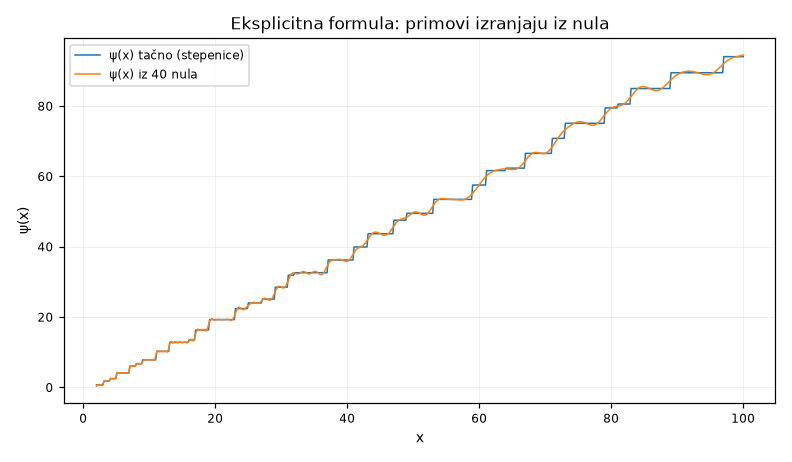

**Pitanje.** Kako iz nula izlaze primovi?

**Parametri.** `x_max=100, n_zeros=40`

**Rezultat.**

| veličina | vrijednost |
|---|---|
| `x_max` | 100.0 |
| `n_zeros` | 40 |
| `max_abs_error` | 2.3658 |
| `mean_abs_error` | 0.4563 |
| `psi_exact_at_xmax` | 94.0453 |
| `psi_approx_at_xmax` | 94.5162 |

Glatka kriva x, korigovana sa **40 nula**, prati tačnu stepenastu funkciju ψ(x) sa srednjom greškom 0.456.

Svaka nula ρ = ½ + iγ doprinosi jedan talas amplitude 2√x/|ρ| i frekvencije γ. Nule su **frekvencije u spektru primova**. Dodaj ih dovoljno i glatka kriva se izlomi tačno na stepenicama primova i njihovih stepena.

Ovdje se vidi zašto je RH važna: amplituda svakog talasa je x^Re(ρ)/|ρ|. Ako sve nule imaju Re(ρ) = ½, greška u brojanju primova je reda √x. Nula sa Re(ρ) = 0.6 dala bi talas koji raste kao x^0.6 i trajno pokvario raspodjelu primova.

---
Reproducibilnost: `lab/explicit-20260727-205132-0a77d0/script.py`, sha256 `5ec8785f537a3c69…`, mpmath 1.3.0, trajanje 2.53 s.

Grana: [[tema-pnt_error]]
