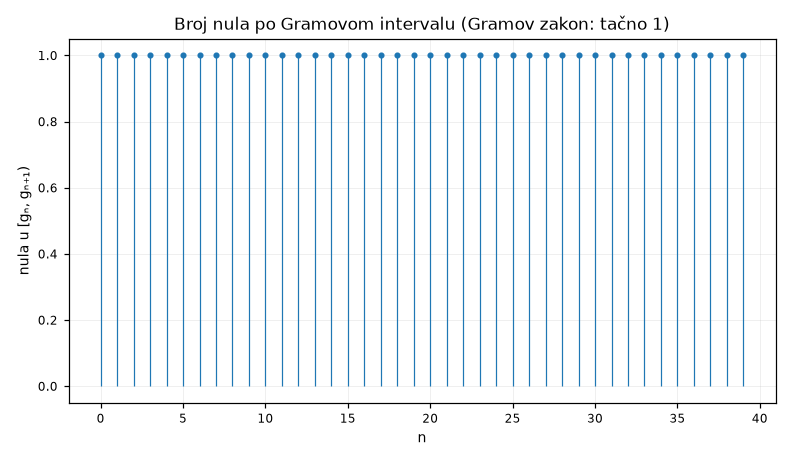

**Pitanje.** Da li svaki Gramov interval sadrži tačno jednu nulu?

**Parametri.** `n_start=0, n_end=40`

**Rezultat.**

| veličina | vrijednost |
|---|---|
| `n_start` | 0 |
| `n_end` | 40 |
| `good_points` | 41 |
| `bad_points` | 0 |
| `intervals` | 40 |
| `gram_law_violations` | 0 |

Gramove tačke g_0 … g_40: 41 'dobrih' (gdje (−1)ⁿ Z(gₙ) > 0), 0 loših.
Od 40 Gramovih intervala, **0** ne sadrži tačno jednu nulu.

Gramov zakon nije teorema nego tendencija — pada beskonačno mnogo puta. Zanimljivo je baš tamo gdje pada: kršenja dolaze u blokovima, i Rosserovo pravilo (svaki Gramov blok sadrži onoliko nula koliko ima intervala) drži i tamo gdje sam Gramov zakon ne drži.

---
Reproducibilnost: `lab/gram-20260727-205509-1c4046/script.py`, sha256 `656bc98138388bfc…`, mpmath 1.3.0, trajanje 18.352 s.

Grana: [[tema-numerics]]
