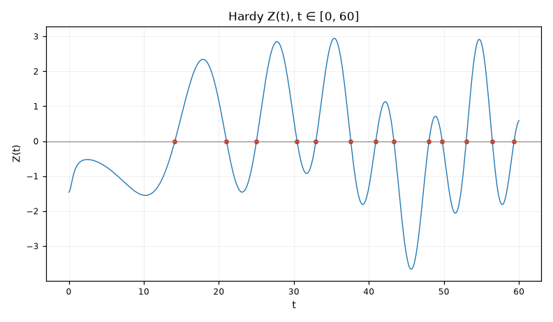

**Pitanje.** Gdje su nule i kako izgledaju?

**Parametri.** `t0=0, t1=60, samples=800`

**Rezultat.**

| veličina | vrijednost |
|---|---|
| `t0` | 0.0 |
| `t1` | 60.0 |
| `step` | 0.075 |
| `zeros_found` | 13 |
| `smooth_prediction` | 11.9582 |
| `max_abs_Z` | 3.6635 |

Na intervalu [0, 60] Z mijenja znak **13 puta** — toliko nula leži NA kritičnoj pravoj u tom rasponu. Glatki član predviđa 11.958. Razlika je S(T), fluktuacija, i ona je mala i spora — to je cijela poenta.

Z je realna funkcija, pa se nule vide golim okom kao presjeci nule. Sve što ovdje vidiš je pod pretpostavkom da nijedna nula nije promašena — ako je korak preveliki, par nula može proći nezapaženo.

---
Reproducibilnost: `lab/z_curve-20260727-205129-390875/script.py`, sha256 `83bbf9c08dbc2fd2…`, mpmath 1.3.0, trajanje 3.055 s.

Grana: [[tema-numerics]]
