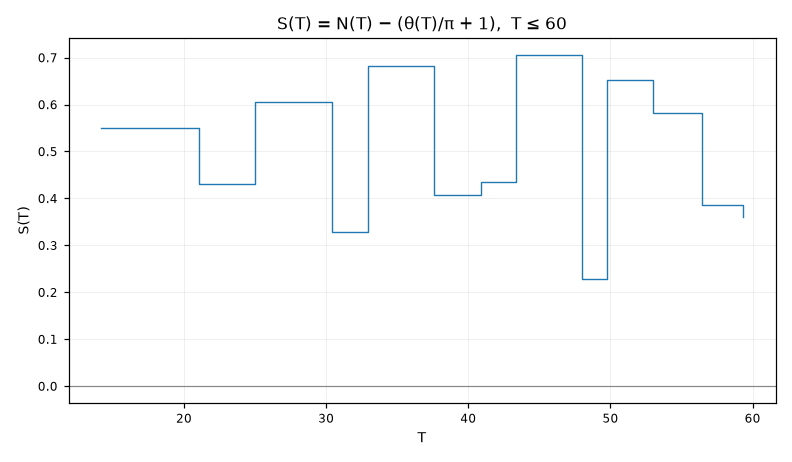

**Pitanje.** Da li je broj nula NA pravoj jednak ukupnom broju nula u traci?

**Parametri.** `T=60, samples_per_unit=8`

**Rezultat.**

| veličina | vrijednost |
|---|---|
| `T` | 60.0 |
| `step` | 0.05 |
| `zeros_on_line` | 13 |
| `N_smooth` | 12.873491 |
| `S_of_T` | 0.126509 |

Do visine T = 60 pronađeno je **13 nula na kritičnoj pravoj**. Glatka formula θ(T)/π + 1 daje 12.8735, pa je S(T) = +0.1265.

Ovo je numerička provjera RH na intervalu (0, 60]: broj nula NA pravoj poklapa se sa ukupnim brojem nula u traci koji predviđa teorija. Da postoji nula van prave ispod ove visine, brojevi se ne bi slagali.

S(T) je mali i mijenja se sporo. Poznato je da S(T) = O(log T) i da ide u ±∞, ali izuzetno sporo — prvi put pređe 3 tek astronomski visoko. To je razlog zašto numerika izgleda tako uvjerljivo, i razlog zašto ne dokazuje ništa.

---
Reproducibilnost: `lab/counting-20260727-205135-b1486b/script.py`, sha256 `53f49bbf03b4ad67…`, mpmath 1.3.0, trajanje 2.96 s.

Grana: [[tema-numerics]]
