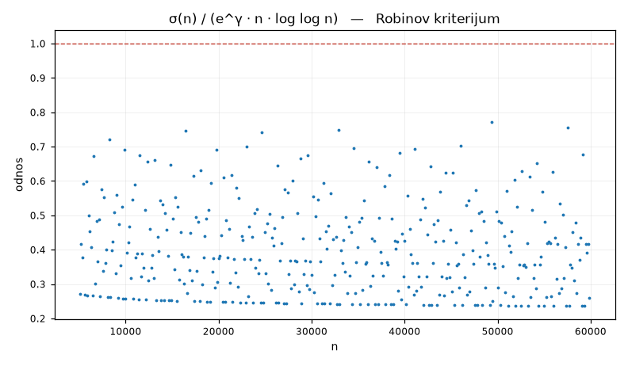

**Pitanje.** Da li σ(n) ostaje ispod e^γ n log log n?

**Parametri.** `n_max=60000`

**Rezultat.**

| veličina | vrijednost |
|---|---|
| `n_max` | 60000 |
| `worst_n` | 10080 |
| `worst_ratio` | 0.98581861 |
| `violations` | 0 |

Za n od 5041 do 60000: najveći odnos σ(n)/(e^γ n log log n) je **0.98581861** kod n = 10080. Kršenja: 0.

Robin (1984): RH je **ekvivalentna** tvrdnji da je taj odnos < 1 za svako n > 5040. Nije posljedica, nego ekvivalencija — jedno jedino kršenje oborilo bi RH.

Zapazi koliko je tijesno: odnos se drži tik ispod 1 i ne pada. Ekstremalni kandidati su superabundantni brojevi (n = 10080 je jedan od njih). Ovo je najkonkretniji oblik u kojem RH postaje tvrdnja o običnim cijelim brojevima — bez ijedne kompleksne funkcije.

---
Reproducibilnost: `lab/robin-20260727-205138-d34d6e/script.py`, sha256 `9489832079a74654…`, mpmath 1.3.0, trajanje 1.278 s.

Grana: [[tema-equivalences]]
